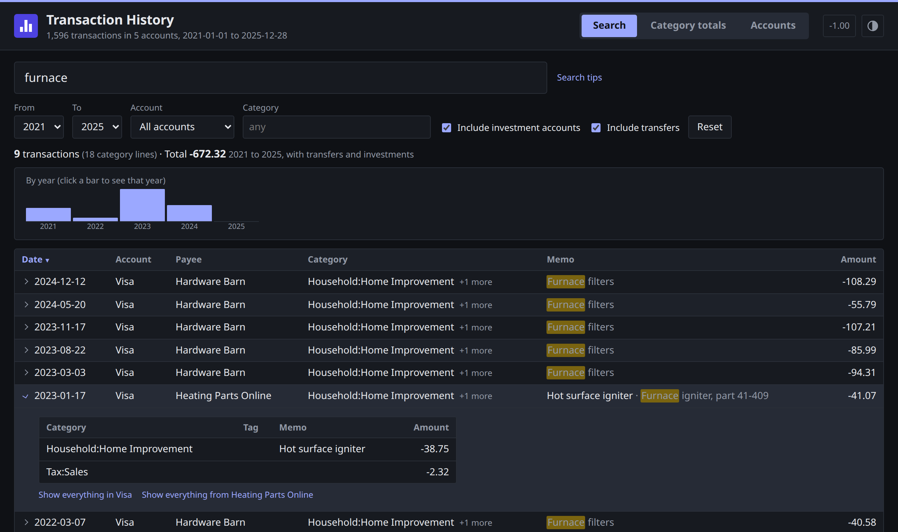
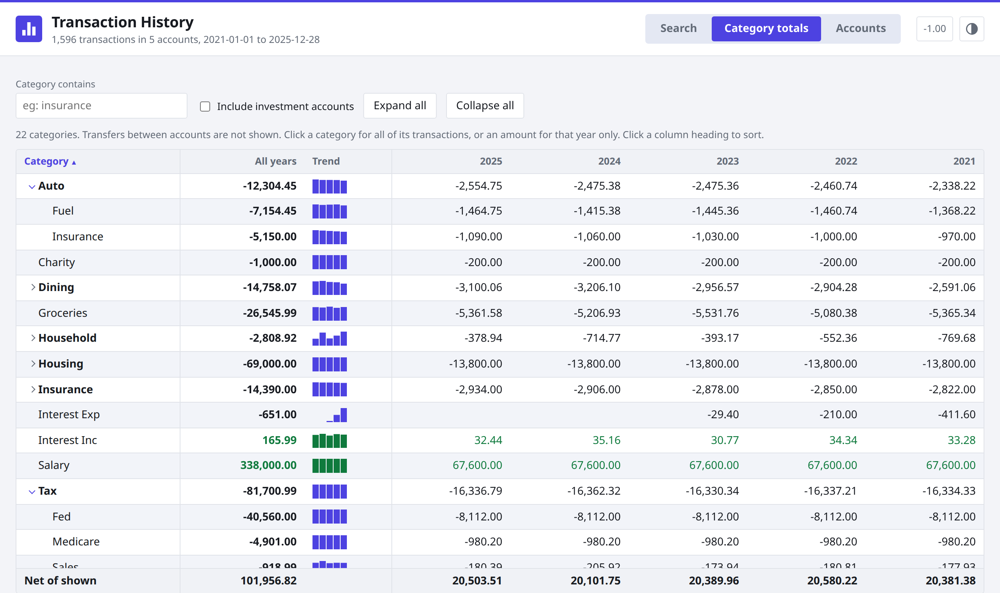

# quicken-to-html

Convert a Quicken for Windows QIF export into a single, searchable HTML file.



## Description

quicken-to-html reads a QIF file that Quicken exports and writes one
HTML file with every transaction embedded in it. The page opens from a folder
in any browser from late 2024 or later (Chrome 123, Firefox 128, Safari 18, or
newer). It needs no server and makes no network requests.

The page has three views:

- Search: finds transactions by payee, memo, category, tag, account, date, or
  amount.
  - Every word typed must match. Quotes keep a phrase together.
  - A number also matches the start of a date (`2016-03`) or an amount (`429`
    matches 429.00 to 429.99).
  - Results filter by year range, account, and category. They sort by date,
    account, payee, category, or amount.
  - A small chart shows the total for each year. Clicking a bar narrows the
    results to that year.
  - Clicking a row shows the whole transaction, including every split line.
- Category totals: one row per category and one column per year.
  - A category with subcategories shows their combined total, and its arrow
    opens it.
  - Clicking a category lists all of its transactions. Clicking an amount
    lists the transactions for that year only.
  - Any column can be sorted.
- Accounts: every account with its transaction count and its first and last
  dates. Clicking an account lists its transactions.

The page follows the light or dark setting of the device, and the Theme
button overrides it. The address changes with each view, so the Back button
and bookmarks work.

**Notes:**

- QIF files from Quicken for macOS are not supported.
- Last tested with Quicken R70.22.

## Screenshots and demo



See a
[live example with fake data here](https://c0nsumer.github.io/quicken-to-html/example/history.html).

## Requirements

Python 3.9 or newer. No other packages are needed.

## Export from Quicken

A .QIF file is required. The transaction report is optional, but the build uses it
to cross-check its own output, so it's a good idea to include it.

QIF, in File -> File Export -> QIF File:

- Quicken Account to Export from: All Accounts
- Include Transactions in Dates: from before the first transaction, to today
  (A later end date includes scheduled transactions that have not happened.)
- Include in Export: everything checked

Transaction report, in Reports -> Banking -> Transaction -> Customize:

- Date range: Include all dates
- Subtotal by: Don't subtotal
- Accounts: all, including hidden accounts
- Categories, Payees, and Tags: everything selected
- Show splits: checked
- Columns: at least Date, Account, Category, and Amount

Use the report's Export button and save it as an Excel workbook (`.xlsx`).

## Usage

1. Clone this repository or download a ZIP file of the repo:
   - `git clone https://github.com/c0nsumer/quicken-to-html.git`
   - [The latest release](https://github.com/c0nsumer/quicken-to-html/releases/latest)
2. Put the `.QIF` file and the `.xlsx` file in the `data/` folder. The file
   names do not matter, but there can be only one of each.
3. Run `./build.py`. On Windows, run `python build.py`.
4. Open `data/history.html` in a browser.

The resulting `history.html` is self-contained. It can be copied anywhere and
does not need the QIF or this repository again.

To use files in another location, name them:

```
./build.py ~/exports/all.QIF --check ~/exports/report.xlsx -o ~/history.html
```

The page heading is "Transaction History" and the accent color is indigo. To
change them, use `--title` and `--accent`. The accent is a hex code:

```
./build.py --title "Household Ledger" --accent "#0a7d5a"
```

## Options

```
./build.py [source] [--check XLSX] [-o OUTPUT] [--title TITLE] [--accent COLOR]
```

- `source`: a QIF file, or a folder holding one `.QIF` and optionally one
  `.xlsx` report. (Default: `data`)
- `--check XLSX`: the transaction report to compare against. (Default: the
  `.xlsx` in the source folder, if there is one.)
- `-o OUTPUT`, `--output OUTPUT`: where to write the page. (Default:
  `history.html` next to the QIF.)
- `--title TITLE`: the heading shown at the top of the page. (Default:
  "Transaction History")
- `--accent COLOR`: the accent color, as a hex code such as `#0a7d5a`.
  (Default: indigo)
- `--version`: show the version and exit.
- `-h`, `--help`: show this list and exit.

## Check

If a transaction report is present, the build compares it with the QIF before
writing anything. It compares the transaction count for each account and the
total of each category for each year. It also matches every line by date,
account, category, and amount. If anything differs, the build prints the
differences and writes no file.

```
read: example.QIF: 1,596 transactions (2,919 lines) in 5 accounts, 2021-01-01 to 2025-12-28
check: against example-report.xlsx
  131 of 131 year-and-category totals match (4 non-investment accounts)
  2,874 of 2,874 lines match by date, account, category, and amount
wrote: example/history.html (0.2 MB)
```

If no report is present, the build skips the check and says so.

Investment accounts are compared by transaction count only. A difference
there is printed as a note and does not stop the build. The report leaves out
lines with a zero amount, so the check does not compare them.

## Example

`example/` holds a made-up household with five accounts, five years, and
~1,600 transactions. `make_example.py` generates the QIF and the report. To
rebuild the example:

```
./make_example.py
./build.py example
```

## Limitations

- A QIF records both buying and selling an investment as positive amounts.
  Investment transactions are searchable, but category totals leave them out
  unless *Include investment accounts* is checked.
- Some Quicken loan accounts export with a blank `!Type:` header. The build
  treats these accounts as loans and prints their names.
- On some paychecks, the split lines add up to more than the net deposit.
  Quicken stores them that way. Category totals use the split lines.
- Only US month-first dates are handled (`1/ 5'26` and `1/ 5/99`).

## Privacy

`history.html` contains every transaction in plain text. Treat it like the
Quicken data file that has no password protection.

## Related projects

- [davidski/quicken-exporter](https://github.com/davidski/quicken-exporter)
  reads the Quicken data file directly and writes a SQLite database.
- [isaacharrisholt/quiffen](https://github.com/isaacharrisholt/quiffen) is a
  QIF parser for Python.

## License

MIT. See [LICENSE](LICENSE). It was developed with AI assistance (Claude
Code).

Quicken is a trademark of Quicken Inc. This project is not affiliated with or
endorsed by Quicken Inc.
